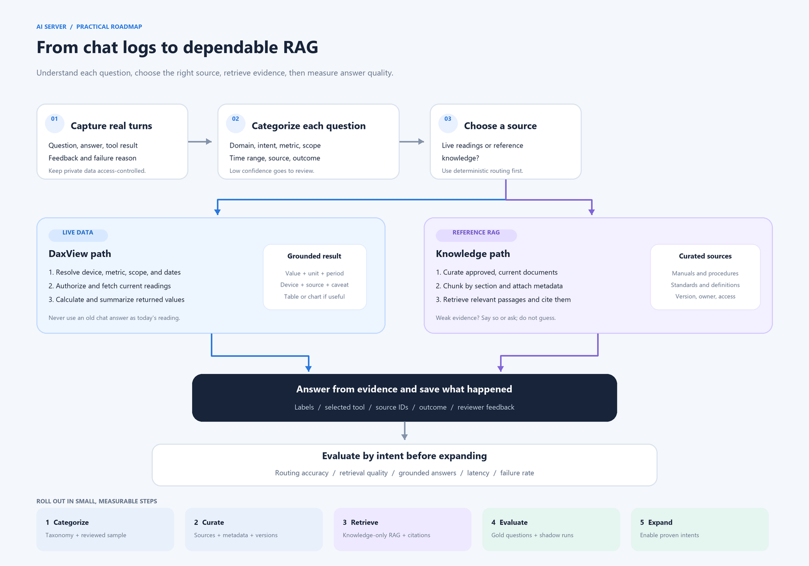

# Gradually Building a Reliable RAG Assistant

## Purpose

This guide describes how to make the AI Server more consistent and easier to improve without starting with model fine-tuning. The recommended path is to capture and categorize real questions, improve deterministic routing, build a small trusted knowledge collection, then evaluate retrieval before expanding it.

RAG means **retrieval-augmented generation**: the system finds relevant, approved information and gives it to the model as context for an answer. RAG is useful for standards, procedures, manuals, and other reference material. It is not a replacement for fetching current readings from DaxView.

## The flow at a glance



[Open the scalable SVG version](RAG_ROADMAP_DIAGRAM.svg).

## What the AI Server already has

The current server has pieces that can support this work:

- PostgreSQL and pgvector tables for documents, document chunks, QA logs, QA embeddings, chat sessions, turns, and debug traces.
- A document ingestion path that splits text into overlapping chunks and stores embeddings.
- A semantic search over `document_chunks`, called for selected general EMS and standards questions.
- QA logging that stores question, answer, EMS relevance, and sources. It also creates a question embedding for EMS-related chat answers.
- DaxView turn records with structured `context` and `resolved_plan` JSON, which can preserve selected scope, operations, and results.
- Debug traces that help explain routing and tool execution. Trace payloads redact free-text content, so they are useful for operational diagnosis but are not a complete question-and-answer training corpus.

There are two important gaps:

1. Answer-time retrieval currently searches document chunks; the QA embeddings are stored but are not used by that retrieval function.
2. QA logs do not have a complete, versioned taxonomy for intent, metric, scope, time range, answer source, and outcome.

The current retrieval settings and embedding model are configuration choices, not quality guarantees. Establish an evaluation set before tuning thresholds or changing embedding models.

The current vector columns are declared as `vector(768)`. Any future embedding model must produce vectors of the same dimension, or the schema and all stored vectors must be migrated and re-embedded together. Never mix vectors from different embedding models in the same search space without an explicit migration plan.

## Keep two kinds of knowledge separate

Use different paths for reference knowledge and live operational data.

| User asks for | Source of truth | Suitable retrieval |
| --- | --- | --- |
| “What does voltage sag mean?” | Approved standards and EMS reference documents | RAG over curated, cited document chunks |
| “How do I acknowledge an alarm?” | Approved operator procedure | RAG over the current procedure version |
| “What was today’s peak demand?” | Current authorized DaxView readings | Deterministic intent routing, then a DaxView tool call |
| “Which device had the highest energy today?” | Current authorized DaxView readings | Site-wide energy ranking tool, then a grounded summary |
| “How did we answer a similar question last month?” | Reviewed historical QA examples, if useful | Search approved examples as phrasing/routing examples, never as current readings |

Do not answer a current-reading question from an old QA answer retrieved by semantic similarity. Historical answers can be stale, site-specific, or from a different time range.

## Phase 1: Define a small, controlled taxonomy

Create a versioned taxonomy before labeling a large log archive. Start with categories that correspond to actions the system can take. Avoid making a new category for every wording variation.

### Suggested top-level domains

- `telemetry`: readings and trends for a named device or metric.
- `energy`: site totals, device energy ranking, and energy breakdowns.
- `demand`: maximum or peak demand summaries and rankings.
- `alarms`: active alarms, alarm history, frequency, and alarm details.
- `devices`: inventory, status, and supported metric discovery.
- `site`: site metadata and general site summaries.
- `forecast`: requested future estimates.
- `knowledge`: EMS concepts, standards, procedures, and troubleshooting guidance.
- `unsupported`: unrelated or unsupported requests.

### Suggested intent labels

Choose one primary intent per request. Add secondary intents only when the question clearly asks for multiple results.

| Intent | Example | Typical route |
| --- | --- | --- |
| `device_timeseries` | “Show voltage for Main Meter for the last 24 hours.” | `telemetry_timeseries` |
| `site_energy_total` | “How much energy did the site use today?” | `site_energy_summary` |
| `device_energy_ranking` | “Which device had the highest energy reading today?” | `device_energy_ranking` |
| `site_demand_ranking` | “What is the peak demand for today?” | `demand_peak_summary` |
| `device_inventory` | “List the available devices.” | `site_device_list` |
| `metric_discovery` | “Which meters support voltage?” | `telemetry_metric_catalog` |
| `alarm_frequency` | “Which alarms occurred most often this week?” | `alarm_frequency_summary` |
| `knowledge_explanation` | “What is voltage sag?” | Curated reference retrieval |
| `procedure_lookup` | “How do I acknowledge this alarm?” | Current approved procedure retrieval |
| `unsupported_request` | A request outside the EMS assistant’s remit | Safe explanation or redirect |

Keep metrics canonical. For example, map `kWh`, `energy`, and `energy consumption` to `energy`; map `maximum demand`, `peak demand`, and `max kW` to `demand`. Preserve the original phrase as well as the normalized value.

## Phase 2: Record a useful, privacy-aware interaction row

For every turn, record a structured interaction record alongside the existing message and answer. A JSONL export is a convenient first format for annotation; PostgreSQL can remain the operational store.

Example:

```json
{
  "record_id": "example-0001",
  "taxonomy_version": "1.0",
  "question": "List out the highest energy reading for today",
  "answer": "96S2_Freezer_3_1 had the highest reading: 123.4 kWh ...",
  "domain": "energy",
  "intent": "device_energy_ranking",
  "secondary_intents": [],
  "metric": "energy_kwh",
  "scope_type": "site",
  "device_reference": null,
  "time_phrase": "today",
  "time_start": "<resolved-start-as-ISO8601>",
  "time_end": "<resolved-end-as-ISO8601>",
  "timezone": "<resolved-site-timezone>",
  "tool_operations": ["device_energy_ranking"],
  "answer_type": ["text", "table"],
  "source_kind": "daxview_live",
  "source_references": [],
  "outcome": "success",
  "answer_quality": "approved",
  "review_status": "reviewed",
  "label_confidence": 1.0
}
```

Use the actual timezone and exact start/end boundaries resolved by the server. The answer and device above are illustrative placeholders, not real readings.

Recommended fields:

- **Request identity:** record, conversation, turn, and request IDs; keep access controls and retention limits.
- **Text:** original user message and final assistant answer, stored in the approved application store. Do not copy secrets or personal information into an evaluation export.
- **Labels:** taxonomy version, domain, primary intent, optional secondary intents, normalized metric, scope, and requested output type.
- **Resolved values:** normalized time range and timezone; site/building/device identifiers should be access-controlled and may need pseudonymized values in analytics exports.
- **Execution:** selected internal operation, public tool, model name/version, retrieved document IDs, source kind, and whether a tool was actually called.
- **Outcome:** completed, clarification, no data, tool error, model error, unsupported, or cancelled.
- **Quality:** reviewer status, groundedness/accuracy rating, feedback, and known issue tags.

Do not treat “the model produced an answer” as a successful outcome. An answer can be wrong, ungrounded, stale, or routed to the wrong tool.

## Phase 3: Categorize every question and answer

Use a two-step labeling process:

1. **Automatic first pass:** deterministic rules assign obvious categories and extract known fields. An LLM can suggest labels for ambiguous items, but it should return a fixed schema and confidence score.
2. **Review queue:** send low-confidence, conflicting, failed, or new-intent items to a human review queue. Reviewers can approve, correct, or mark a new intent as unsupported.

Enforce these rules:

- Every record has a taxonomy version and a review state.
- `unknown` or `needs_review` is an allowed temporary label; a guessed label is not.
- Keep user wording and normalized labels separately.
- Permit multiple labels only for questions that really request multiple tasks.
- Record why an answer failed: wrong intent, missing scope, DaxView no data, tool error, Ollama error, unsupported question, or answer quality issue.
- Do not promote low-confidence or unreviewed answers into the approved retrieval set.
- Track uncategorized rate and review backlog so “all categorized” is measurable rather than assumed.

### Practical review categories

Reviewers should be able to apply a small set of answer judgments:

- `correct_and_grounded`
- `correct_but_incomplete`
- `wrong_intent`
- `wrong_scope_or_period`
- `unsupported_claim`
- `stale_or_wrong_source`
- `tool_or_data_failure`
- `needs_specialist_review`

## Phase 4: Build the knowledge corpus carefully

Start with a small set of authoritative, approved materials:

- operator procedures and escalation steps;
- internal EMS how-to guides;
- approved definitions and calculation notes;
- standards excerpts the organization is permitted to use;
- site-specific reference documents that are safe to retrieve for the current user.

For every source document, prepare metadata:

- stable document ID, title, owner, source type, version, and effective date;
- approval status, review date, and expiry/replacement information;
- access scope, such as global, company, site, or user role;
- section heading, page, and source URL or file reference;
- language and content type.

Prefer chunks aligned to headings, procedures, or concepts. Avoid splitting a warning from the steps it qualifies. Preserve section/page references so the answer can cite the source. Remove obsolete versions from the active retrieval set, but retain them in controlled history if audit policy requires it.

The existing character-count chunker is a useful prototype. Later, improve it with heading-aware chunking, document/version metadata, and explicit citations. Do not change the embedding model until a representative retrieval evaluation set exists.

## Phase 5: Add retrieval in safe steps

1. Keep deterministic routing for structured DaxView operations. Use RAG only for knowledge questions and approved historical examples.
2. Start with the current document search and add citations in the answer: document title, version, section, and page when available.
3. Add metadata filters before expanding the corpus: active version, approved status, access scope, and content type.
4. Evaluate lexical search alongside vector search. Exact device names, alarm IDs, standard numbers, and procedure codes often need keyword matching.
5. Consider a hybrid score and a reranker only after measuring retrieval quality. Start with a small top-k and tune the threshold from labeled queries, not intuition.
6. Retrieve QA examples only when they are reviewed and relevant to the same intent. Use them to help interpret phrasing or response format, not to supply current telemetry facts.
7. If evidence is weak or conflicting, abstain or ask a targeted clarification. Do not fill the gap with a confident guess.

Suggested high-level flow:

```text
User question
    -> classify intent and extract metric, scope, and period
    -> if live data: authorize and call the matching DaxView tool
    -> if reference knowledge: retrieve approved, current document chunks
    -> answer from returned data/evidence and cite the source
    -> save labels, outcome, source references, and feedback
```

## Phase 6: Prepare an evaluation set before broad rollout

Create a version-controlled set of representative questions and expected labels. Include paraphrases and difficult cases, not just clean examples.

For each major intent, include:

- ordinary wording and spelling variations;
- site-wide versus named-device wording;
- relative periods such as “today” and explicit date ranges;
- missing metric, missing period, or ambiguous device cases;
- similar terms that must route differently, such as site energy total versus device energy ranking;
- no-data and tool-failure outcomes;
- unrelated and unsupported requests.

Measure separately:

- **Classification:** accuracy by domain/intent, confusion between similar intents, and unknown/low-confidence rate.
- **Slot extraction:** metric, device, scope, dates, and timezone accuracy.
- **Tool selection:** correct operation and correct authorization scope.
- **Retrieval:** whether the approved supporting chunk appears in top-k; citation correctness; stale-source rate.
- **Answer quality:** factual grounding, completeness, correct units, correct period, and appropriate abstention.
- **Operations:** latency, model/tool failure rate, and cost per intent.

Keep the evaluation set stable across changes. Run the same set when changing the taxonomy, routing rules, embedding model, chunking, or retrieval settings. Add reviewed production failures as new cases.

## Phase 7: Roll out gradually

### Stage A — Capture and classify

Add the taxonomy and outcome fields to new interaction records. Export a small historical sample, redact it, label it, and measure how many records need review. Do not use debug traces as a substitute for full QA records because their text is deliberately redacted.

### Stage B — Knowledge-only RAG

Use curated document retrieval for standards, definitions, and procedures. Keep live data questions on the current DaxView path. Require citations and log retrieved document IDs and scores.

### Stage C — Shadow evaluation

Run new classifiers or retrieval settings beside the current route without changing the user response. Compare their predicted category, tool, and retrieved sources against approved labels.

### Stage D — Limited production use

Enable retrieval only for well-performing knowledge intents. Keep low-confidence questions on the existing safe route or ask for clarification. Monitor per-intent metrics and roll back a change if quality regresses.

### Stage E — Reviewed QA examples

Only after the knowledge path is reliable, add a small approved QA-example collection. Require the same intent, compatible access scope, and no dependency on stale readings. Keep raw historical answers out of the model context unless their source and timestamp are explicit.

## What to prepare first

1. A versioned intent/metric/scope taxonomy with an `unknown` and `needs_review` path.
2. A privacy and retention decision for questions, answers, tool arguments, device names, and user identifiers.
3. An export of representative full QA records and DaxView outcomes from approved storage, separate from redacted debug traces.
4. A reviewer checklist for intent, slots, source grounding, outcome, and answer quality.
5. A small gold evaluation set for the high-volume intents: device readings, energy totals/rankings, demand, alarms, inventory, and EMS knowledge.
6. A curated, versioned document set with owners and access scopes.
7. A measured baseline for routing accuracy, answer quality, latency, and failures before rollout.

## When to consider fine-tuning

Fine-tuning is a later option for consistent style or repeated structured classification after the taxonomy and labels are stable. It is not a way to give the model current readings, replace retrieval, or fix a broken tool route. First prove that a fixed evaluation set improves with deterministic rules, better prompts, and curated retrieval. If fine-tuning is later justified, use reviewed, privacy-approved examples and preserve a holdout evaluation set.

## Suggested first milestone

Start with a small, reviewable milestone: define the taxonomy; label 100–200 representative questions across the main intents; include failures and ambiguous examples; create a fixed routing evaluation set; and curate a few authoritative EMS documents. Use the results to fix deterministic routing and validate knowledge retrieval before indexing the entire history.

